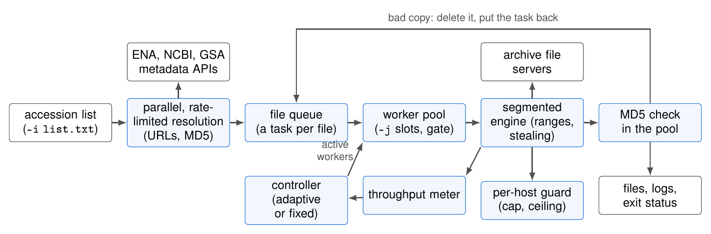

<h1 align="center">
  
</h1>

<p align="center"><b>An adaptive tool to fetch public sequencing data</b></p>

<p align="center">
  <a href="https://github.com/swargo98/adaptiSeq/blob/main/LICENSE"></a>
  <a href="https://www.python.org/"></a>
  <a href="https://pypi.org/project/adaptiseq/"></a>
  <a href="https://github.com/swargo98/adaptiSeq/actions/workflows/ci.yml"></a>
  <a href="https://swargo98.github.io/adaptiSeq/"></a>
  <a href="https://colab.research.google.com/github/swargo98/adaptiSeq/blob/main/adaptiSeq_Colab_Quickstart.ipynb"></a>
</p>

<p align="center">
  <a href="https://swargo98.github.io/adaptiSeq/"><b>📖 Documentation</b></a>
  &nbsp;·&nbsp;
  <a href="#installation">Installation</a>
  &nbsp;·&nbsp;
  <a href="#usage">Usage</a>
  &nbsp;·&nbsp;
  <a href="#related-tools">Comparison</a>
</p>

## Description

**adaptiSeq** is a fast, importable Python tool that downloads sequencing data and
metadata from **[GSA](https://ngdc.cncb.ac.cn/gsa/)**,
**[SRA](https://www.ncbi.nlm.nih.gov/sra/)**,
**[ENA](https://www.ebi.ac.uk/ena/)**,
**[DDBJ](https://www.ddbj.nig.ac.jp/)**, and
**[GEO](https://www.ncbi.nlm.nih.gov/geo/)**. It is built for the workload real
pipelines actually have: **lists of accessions**, downloaded in parallel, with a
**segmented, resumable, self-tuning** engine and a **real Python API**.

> **Important**
> To use adaptiSeq your system must be **connected to the network** and able to
> reach the databases over **HTTP, HTTPS, and (optionally) FTP / Aspera**.

## What's new in 0.1.12

The first release since 0.1.3, and the build behind the benchmarks in the accompanying manuscripts:

- **Delivered means verified, and the exit status says so.** Each file is checked against the archive's md5
  as it lands, and a bad copy is deleted and fetched again inside the pool. A Run that cannot be verified is
  written to `fail.log` and the exit status is 1. A Run that ENA cannot serve is fetched from NCBI SRA by
  default, with an announcement; `--no-sra-fallback` refuses it, because SRA copies cannot be checked against
  ENA's md5.
- **Metadata failures are not read as answers.** A failed or empty ENA query is retried before a Run is
  declared absent.
- **Connections stay busy.** Files are split into ranges that idle connections take over, and the per-host
  guard treats a refused connect as a ceiling to wait at.
- **Five adaptive controllers** (`--controller topdown|bottomup|budget|greedy|knee`); `topdown` is the default.
- **GSA and GEO work again** after both archives put browser checks on their pages.

The full list of changes is in the [changelog](https://github.com/swargo98/adaptiSeq/blob/main/CHANGELOG.md).

## How it works

<p align="center">
  
</p>

An accession list is resolved in parallel under per-archive request limits. Each file becomes a task; workers
take tasks, the segmented engine splits each file into byte ranges on several connections, a per-host guard
bounds the connections and reacts to refusals, and each finished file is md5-checked inside the pool, with a bad
copy going back to the queue. A controller (adaptive or fixed) sets how many files are in flight. Details:
[Method details](https://swargo98.github.io/adaptiSeq/methods/).

## Features
- **Five archives**: GSA / SRA / ENA / DDBJ / GEO, from any Project, Study, BioSample, Sample, Experiment or
  Run accession, single or a file of many (mixed archives allowed).
- **Verified delivery**: every file is md5-checked in the worker pool as it lands, a bad copy is fetched again
  in parallel, and the exit status is non-zero when a Run could not be delivered and verified (`fail.log`
  names it).
- **Batch-parallel download** of accession lists (`-j`) through an asyncio worker pool, with **adaptive**
  concurrency (`--adaptive`, `--controller`) and **parallel, rate-limited metadata resolution** (`--meta-jobs`).
- **Segmented, resumable transfers** (HTTPS-first for ENA): interrupt and re-run to continue, not restart.
- **Importable Python API** (`fetch`, `resolve`, `get_metadata`) that returns values and raises typed
  exceptions.

<details>
<summary>More features</summary>

- **Metadata download**: per-accession sample metadata (`-m`).
- **File-format selection**: direct gzip FASTQ (`-g`) or SRA→FASTQ conversion (`-q`), multi-threaded (`-t`).
- **File merging** per Experiment/Sample/Study (`-e`).
- **ENA or nothing** when you need it: `--no-sra-fallback` fails a Run instead of fetching an unverifiable
  copy from SRA.
- **Aspera high-speed download** for GSA/ENA (`-a`), with an adaptive pool for ENA.
- **Automatic retry** (up to three rounds) and **md5 / `vdb-validate` verification**.
- **3-file runs** (orphan/barcode + `_1` + `_2`) downloaded correctly.
- **Error handling**: clear, actionable messages with suggested solutions.

</details>

## Installation

### 1. From PyPI
```bash
pip install adaptiseq
adaptiseq --version
```
pip installs only the Python package; the external tools below come from your system or from conda
(`conda install -c conda-forge -c bioconda wget axel pigz coreutils sra-tools`).

### 2. Conda (installs every external tool too)
```bash
conda install -c conda-forge -c bioconda adaptiseq     # once accepted into bioconda
```
Until the bioconda package is live, build it from the in-repo recipe
([`recipe/meta.yaml`](https://github.com/swargo98/adaptiSeq/blob/main/recipe/meta.yaml)); see
[the installation guide](https://swargo98.github.io/adaptiSeq/installation/).

### 3. From source (development)
```bash
git clone https://github.com/swargo98/adaptiSeq.git
cd adaptiSeq
conda env create -f environment.yml && conda activate adaptiseq   # tools + editable install
# or, if the external tools are already installed: pip install -e .
adaptiseq --version
```

External tools: `wget` (always), `sra-tools`, `pigz`, `md5sum`,
`axel` (classic `-p`), and IBM `ascp` (`-a`). adaptiSeq requires each **only when a
run actually needs it**. Full detail: **[the installation guide](https://swargo98.github.io/adaptiSeq/installation/)**.

## Example

1. Download all Runs and metadata for an accession.
```bash
adaptiseq -i PRJNA211801
```

2. Batch download a list, directly as gzip FASTQ, through the adaptive pool.
```bash
adaptiseq -i SRR_Acc_List.txt -g
```

See **[more examples](https://swargo98.github.io/adaptiSeq/examples/)** for more.

## Usage

```
$ adaptiseq --help

Usage:
  adaptiseq -i accession [options]

Required option:
  -i, --input     [text|file]   Single accession or a file containing multiple accessions.
                                Note: only one accession per line in the file.

Optional options:
  -m, --metadata                Skip the sequencing data downloads and only fetch metadata.
  -g, --gzip                    Download FASTQ files in gzip format directly (*.fastq.gz).
  -q, --fastq                   Convert SRA files to FASTQ format.
  -t, --threads   int           Threads for SRA->FASTQ / compression (default: 8).
  -e, --merge     [ex|sa|st]    Merge fastq files per Experiment, Sample, or Study.
  -d, --database  [ena|sra]     Force database for SRA data (default: auto-detect).
      --no-sra-fallback         Fail a Run that ENA cannot serve instead of fetching it from SRA,
                                so every kept file can be checked against ENA's md5.
  -p, --parallel  int           axel connection count (classic engine only), e.g. -p 10.
  -a, --aspera                  Use Aspera (ascp); GSA/ENA only.
  -s, --speed     int           Download speed limit (MB/s) (default: 1000).
  -k, --skip-md5                Skip the md5 check for downloaded files.
  -r, --protocol  [ftp|https]   ENA transport (default: auto, HTTPS-first).
  -Q, --quiet                   Suppress download progress bars.
  -o, --output    text          Output directory (created if missing; default: cwd).

Engine / batch / adaptive:
  --engine        [segmented|classic]   Download engine (default: segmented).
  --segment-size  int           Target segment size in MB (default: 512).
  --max-segments  int           Max connections per file (default: 8).
  --max-conns-per-host int      Cap on connections to one host (default: auto = -j x --max-segments;
                                the circuit breaker still lowers it on 429/503).
  -j, --jobs      int           Max worker-pool size for batch download (default: 20).
  --adaptive / --no-adaptive    Adaptive concurrency (default: on); --no-adaptive runs all -j workers.
  --controller    name          Adaptive controller: topdown (default), bottomup, budget, greedy, knee.
  --probe-window  int           Adaptive probe window in seconds (default: 5).
  --cc-penalty    float         Worker-cost penalty K in score=throughput/K**workers (default: 1.01).
  --meta-jobs     int           Parallelism for metadata/URL resolution (default: 3).
  --aspera-efficiency float     Keep an extra ascp worker only above this efficiency (default: 0.70).

  -h, --help                    Show the help information.
  -v, --version                 Show the program version.
```

### 1. `-i`, `--input`

Input the accession to download, or a **file** with one accession per line
(databases may be mixed). adaptiSeq retrieves the accession's metadata, then
downloads each Run it contains.

```bash
adaptiseq -i PRJNA211801
adaptiseq -i accessions.txt        # batch
```

Currently **supports 6 accession formats** across **5 databases**:

| Databases | BioProject | Study | BioSample | Sample | Experiment | Run  |
| --------- | ---------- | ----- | --------- | ------ | ---------- | ---- |
| **GSA**   | PRJC       | CRA   | SAMC      | \      | CRX        | CRR  |
| **SRA**   | PRJNA      | SRP   | SAMN      | SRS    | SRX        | SRR  |
| **ENA**   | PRJEB      | ERP   | SAME      | ERS    | ERX        | ERR  |
| **DDBJ**  | PRJDB      | DRP   | SAMD      | DRS    | DRX        | DRR  |
| **GEO**   | GSE        | \     | GSM       | \      | \          | \    |

GEO `GSE/GSM` accessions are resolved to their associated `PRJNA/SAMN` and then
downloaded from SRA. Every contained Run is **md5-checked**; on mismatch adaptiSeq
retries up to **three rounds**, recording results in `success.log` / `fail.log`.

### 2. `-m`, `--metadata`

Download only the sample metadata and skip the sequence data.

```bash
adaptiseq -i PRJNA211801 -m
adaptiseq -i CRR343031 -m
```

ENA → TSV (`${accession}.metadata.tsv`); GSA → CSV + project XLSX
(`${accession}.metadata.csv`, `CRA*.metadata.xlsx`). Details:
**[the metadata guide](https://swargo98.github.io/adaptiSeq/usage/metadata/)**.

### 3. `-g`, `--gzip`

Download FASTQ directly in gzip format; if unavailable on ENA, download the `.sra`
and convert with `fasterq-dump` + `pigz`.

```bash
adaptiseq -i SRR1178105 -g
```

### 4. `-q`, `--fastq`

Convert the downloaded `.sra` into FASTQ (single-cell friendly: `I1/R1/R2/R3`).

```bash
adaptiseq -i SRR1178105 -q -t 10
```

### 5. `-e`, `--merge`

Merge a group of Runs into one FASTQ per Experiment (`ex`), Sample (`sa`), or
Study (`st`).

```bash
adaptiseq -i SRX003906 -g -e ex
```

### 6. `-d` / `-r` / `-p` / `-s` / `-k` / `-Q`

Force database (`-d ena|sra`), ENA transport (`-r https|ftp`, default auto
HTTPS-first), classic-engine axel connections (`-p`, with `--engine classic`),
speed cap (`-s` MB/s), skip md5 (`-k`), and quiet (`-Q`). See
**[the download guide](https://swargo98.github.io/adaptiSeq/usage/download/)**.

### 7. Batch & adaptive (`-j`, `--adaptive`, `--meta-jobs`)

For accession lists, adaptiSeq resolves in parallel (`--meta-jobs`) then downloads
through an asyncio worker pool (`-j`) whose active size the adaptive controller
tunes (`--adaptive`; `topdown` by default, others with `--controller NAME` — see
[the controller page](https://swargo98.github.io/adaptiSeq/ADAPTIVE_CONTROLLER/)).

```bash
adaptiseq -i accessions.txt -g -j 8
adaptiseq -i accessions.txt -g --no-adaptive              # all -j workers, no probing
adaptiseq -i accessions.txt -g --controller budget        # fewest connections
adaptiseq -i accessions.txt -g --no-sra-fallback          # ENA only, every file md5-checked
```

Full detail: **[the batch & adaptive guide](https://swargo98.github.io/adaptiSeq/usage/batch/)**.

### 8. `-a`, `--aspera`

Use IBM Aspera (`ascp`); **GSA/ENA only**. ENA uses an **adaptive** parallel pool
(efficiency hysteresis); GSA is sequential, best-effort (Huawei-Cloud preferred).

```bash
adaptiseq -i PRJNA211801 -a -g
```

Detail: **[the Aspera guide](https://swargo98.github.io/adaptiSeq/usage/aspera/)**.

### 9. Python API

```python
from adaptiseq import fetch, resolve, get_metadata

rows   = get_metadata("SRR7706354")               # parsed metadata rows
urls   = resolve("SRR7706354", database="ena")    # resolved URLs (no download)
result = fetch("accessions.txt", outdir="data/", gzip=True, jobs=20, adaptive=True,
               controller="topdown")
print(result.success_ids, result.fail_ids, result.failed)
```

The API never calls `sys.exit` and never prints colour codes; it raises the typed
exceptions in `adaptiseq.errors`. Full reference:
**[the Python API reference](https://swargo98.github.io/adaptiSeq/usage/python-api/)**.

## Output

- **SRA / ENA / DDBJ / GEO** accessions:

| Output        | Description |
| ------------- | ----------- |
| SRA files     | Convert to FASTQ with `-q` |
| `.metadata.tsv` | Metadata for the query accession |
| `success.log` | Runs downloaded successfully |
| `fail.log`    | Runs that failed |

**Exit status.** `0` when every requested Run was delivered; `1` when any Run failed
(it is named in `fail.log`) or the command could not run. A file that fails its md5
check is deleted and fetched again, up to three rounds. A Run that ENA cannot serve is
downloaded from NCBI SRA unless `--no-sra-fallback` is given; the fallback is announced
and counts as delivered (its converted FASTQ is validated, but cannot be compared with
ENA's md5).

- **GSA** accessions:

| Output         | Description |
| -------------- | ----------- |
| GSA files      | Mostly `*.gz` (a few bam/tar/bz2) |
| `.metadata.csv`  | Metadata for the query accession |
| `.metadata.xlsx` | Project metadata (xlsx) for the accession |
| `success.log`  | Runs downloaded successfully |
| `fail.log`     | Runs that failed |

## Documentation

Full documentation lives in **[`docs/`](https://swargo98.github.io/adaptiSeq/)**:
[Installation](https://swargo98.github.io/adaptiSeq/installation/) ·
[Usage overview](https://swargo98.github.io/adaptiSeq/usage/) ·
[Downloading](https://swargo98.github.io/adaptiSeq/usage/download/) ·
[Metadata](https://swargo98.github.io/adaptiSeq/usage/metadata/) ·
[Merging](https://swargo98.github.io/adaptiSeq/usage/merge/) ·
[Batch & adaptive](https://swargo98.github.io/adaptiSeq/usage/batch/) ·
[Aspera](https://swargo98.github.io/adaptiSeq/usage/aspera/) ·
[Python API](https://swargo98.github.io/adaptiSeq/usage/python-api/) ·
[Method details](https://swargo98.github.io/adaptiSeq/methods/) ·
[Adaptive controller](https://swargo98.github.io/adaptiSeq/ADAPTIVE_CONTROLLER/) ·
[Comparison](https://swargo98.github.io/adaptiSeq/comparison/) ·
[Examples](https://swargo98.github.io/adaptiSeq/examples/) ·
[FAQ](https://swargo98.github.io/adaptiSeq/faq/) ·
[Changelog](https://swargo98.github.io/adaptiSeq/changelog/).

## Related tools

adaptiSeq sits among other downloaders for public sequencing data —
[iSeq](https://github.com/BioOmics/iSeq),
[fastq-dl](https://github.com/rpetit3/fastq-dl),
[fetchngs](https://github.com/nf-core/fetchngs),
[pysradb](https://github.com/saketkc/pysradb), and
[Kingfisher](https://github.com/wwood/kingfisher-download). A comparison:

**Features compared in the paper** (Table I of the manuscript; versions as benchmarked, read from each
tool's help output, source and documentation):

| Feature | adaptiSeq 0.1.12 | iSeq 1.9.9 | Kingfisher 0.5.0 | fastq-dl 4.0.1 | fetchngs 1.13.0 | pysradb 2.5.1 |
| ------- | :--------------: | :--------: | :--------------: | :------------: | :-------------: | :-----------: |
| Accession list in one call | ✔ | ✔ | ✔ | – | ✔ | project |
| Several runs at once | **✔** | – | – | – | ✔ | ✔ |
| Rate-limited parallel resolution | **✔** | – | – | – | no cap | – |
| MD5 check | ✔ | ✔ | optional | ✔ | ✔ | – |
| Resume partial file | ✔ | ✔ | – | – | per task | ✔ |
| Merge runs | ✔ | ✔ | – | ✔ | – | – |
| Python API | **✔** | – | ✔ | – | – | ✔ |
| GSA | ✔ | ✔† | experimental | – | – | – |
| GEO | ✔ | ✔† | – | – | ✔ | ✔ |
| Installation | pip (conda: pending) | conda | pip, conda | pip, conda | Nextflow | pip, conda |

† iSeq 1.9.9 lists GSA and GEO, but in our tests on 2026-10-19 its GSA run ended with exit status 0 and no data
file, and its GEO accession was rejected, after both archives added browser checks to the pages iSeq reads.
adaptiSeq reads GSA's run-info table and resolves GEO through NCBI E-utilities instead.

**More detail** (not in the paper's table):

| Software | Language | Databases | Accessions | Formats | Methods | Metadata | Several connections per file | Adaptive | Skip done |
| -------- | -------- | --------- | ---------- | ------- | ------- | :------: | :--------------------------: | :------: | :-------: |
| **adaptiSeq** | Python | GSA, SRA, ENA, DDBJ, GEO | All | fq, fq.gz, sra, bam | segmented http(s)/ftp, aspera, wget/axel | ✔ | ✔ | **✔** | ✔ |
| [iSeq](https://github.com/BioOmics/iSeq) | Shell | GSA†, SRA, ENA, DDBJ, GEO† | All | fq, fq.gz, sra, bam | wget, axel, aspera | ✔ | ✔ (`-p`) | – | ✔ |
| [Kingfisher](https://github.com/wwood/kingfisher-download) | Python | SRA, ENA, DDBJ, GSA (experimental) | All except GEO | fq, fq.gz, sra | curl, aria2c, aspera | ✔ | ✔ (`--download-threads`) | – | ✔ |
| [fastq-dl](https://github.com/rpetit3/fastq-dl) | Python | SRA, ENA, DDBJ | All except GSA/GEO | fq, fq.gz, sra | wget | ✔ | SRA only (`--connections`) | – | ✔ |
| [fetchngs](https://github.com/nf-core/fetchngs) | Nextflow | SRA, ENA, DDBJ, GEO | All except GSA | fq, fq.gz | wget, aspera, prefetch | ✔ | – | – | ✔ |
| [pysradb](https://github.com/saketkc/pysradb) | Python | SRA, ENA, GEO | Study, Experiment, GEO | fq, fq.gz, sra, bam | requests, aspera | ✔ | – | – | ✔ |

> **Several runs at once** = many accessions downloaded in parallel in one run, not one after another ·
> **Rate-limited parallel resolution** = accession-to-URL lookups run concurrently under a per-endpoint
> request-rate cap · **Adaptive** = a controller that tunes the number of concurrent downloads from measured
> throughput · **Python API** = an importable library (`fetch`/`resolve`/`get_metadata`), not only a command-line tool.
> The SRA Toolkit and enaBrowserTools are not compared here.

In this comparison no other tool combines batch download, adaptive concurrency and a
Python API. adaptiSeq pairs them with **rate-limited parallel metadata
resolution** and a **segmented, resumable** engine, so a list of hundreds of
accessions is resolved and downloaded concurrently, self-tuning to the throughput
the servers actually give — from a script, notebook, or the shell.

## Contributing

Contributions are welcome — please open an issue for bugs/suggestions, or fork,
branch, and submit a pull request. The offline test suite runs with
`python -m pytest`.

## Cite us

A manuscript describing adaptiSeq is in preparation; until it appears, cite the
software with the metadata in [`CITATION.cff`](https://github.com/swargo98/adaptiSeq/blob/main/CITATION.cff).

## Acknowledgements

adaptiSeq descends from two earlier tools:
**[iSeq](https://github.com/BioOmics/iSeq)** (Chao H, Li Z, Chen D, Chen M.
*Bioinformatics*, 2024,
[doi:10.1093/bioinformatics/btae641](https://doi.org/10.1093/bioinformatics/btae641)),
whose command-line options and accession handling it started from, and
**FastBioDL** (Swargo RM, Arslan E, Arifuzzaman M.
[arXiv:2508.05511](https://arxiv.org/abs/2508.05511)), the origin of its segmented
transfer engine. Both are MIT-licensed and their notices are in [`LICENSE`](https://github.com/swargo98/adaptiSeq/blob/main/LICENSE).

## License

This project is licensed under the [MIT License](https://github.com/swargo98/adaptiSeq/blob/main/LICENSE), which also reproduces the
notices of the two tools in [Acknowledgements](#acknowledgements).
