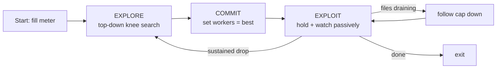

# Adaptive controllers

How adaptiSeq decides *how many workers to run* (or how many connections to
hold) during a batch download, so you do not have to pick `-j` by hand.

Five controllers ship with 0.1.12. Choose one with `--controller NAME` (or
`fetch(controller="NAME")`); `topdown` is the default.

| Controller | What it steers | In one sentence |
|---|---|---|
| `topdown` *(default)* | the number of active **workers** (files in flight) | explore from the most workers downward to find the knee, commit, then hold and watch |
| `bottomup` | the number of active workers | the original gradient optimizer; probes up and down for the whole run |
| `greedy` | the number of active workers | every worker runs; backs off by a quarter on HTTP 429/503 and climbs back by a tenth per quiet window |
| `budget` | a per-host **connection budget** (every worker active) | raise while it pays, revert and try a quarter cut when it does not, cut 30 % on pushback |
| `knee` | a per-host connection budget | start at 4 connections, double while each doubling pays, settle on the smallest budget that paid, then re-test now and then |

`ASEQ_ADAPTIVE_MODE` (`topdown`, `bottomup`, …) selects the controller when neither
the flag nor the argument is given; the legacy value `climb` is an alias for
`topdown`. Implementation: `adaptiseq/batch.py`, `AdaptiveController`.

The rest of this page describes `topdown`, then what the benchmark showed.

---

## `topdown`: the idea in one sentence

**Explore top-down to find the knee, commit to it, then hold — re-exploring only
if throughput drops in a sustained way.**

A *worker* holds one file; a file is split into up to `--max-segments` TCP
connections. `topdown` tunes the **worker count**, i.e. how many files are in
flight at once.



---

## `topdown` parameters

| Knob | Env var | Default | Meaning |
|---|---|---|---|
| probe window | `--probe-window` / `ASEQ_PROBE_WINDOW` | 5 s | seconds of throughput averaged per measurement |
| settle | `ASEQ_TOPDOWN_SETTLE` | 1.5 s | wait after changing the worker count before measuring |
| settle after a step up | `ASEQ_TOPDOWN_SETTLE_UP` | 5 s | extra wait after raising the count, for the new files to connect |
| drain wait | `ASEQ_TOPDOWN_DRAIN_S` | 60 s | how long to wait for the files in flight to reach a new count before measuring |
| step-down threshold | `ASEQ_TOPDOWN_THRESHOLD` | 0.10 | fewer workers must beat more by **>10 %** to step down |
| re-probe period | `ASEQ_EXPLOIT_REPROBE_S` | 20 s | how often the exploit phase samples throughput |
| re-explore drop | `ASEQ_EXPLOIT_REDO` | 0.35 | a **>35 %** sustained drop below baseline triggers re-explore |
| — (baseline smoothing) | — | EWMA 0.8/0.2 | baseline = `0.8·baseline + 0.2·sample` |

The pre-rebrand names `ASEQ_CLIMB_SETTLE` / `ASEQ_CLIMB_THRESHOLD` are still read as
fallbacks when the `ASEQ_TOPDOWN_*` equivalents are unset. The other controllers read
`ASEQ_BUDGET_*`, `ASEQ_KNEE_*` and `ASEQ_GREEDY_WINDOW` (window, start, floor).

---

## Phase 1 — EXPLORE (top-down knee search)

Start at the **cap** (all workers that have files to hold) and step *down* only
while fewer workers is *clearly* better. On a healthy link "more is better", so
the cap wins in about two probes with no slow crawl-up. When high concurrency is
being throttled, fewer workers measures faster, so it walks down to the knee.

A count is measured only once the files in flight have come down (or up) to it.
If large files do not drain within the drain wait, there is no clean reading at the
lower count and the higher one is kept. A step down must also win over a second
window (GSA's cut streams make a single window noisy).

```
cap = min(jobs, files_remaining)
best_w, best_t = cap, measure(cap)
w = cap
while w > 1:
    lower = w // 2
    t = measure(lower)               # None if the pool never reached `lower`
    if t is None: break              # keep the higher count
    if t > best_t * (1 + 0.10):      # looks clearly better ...
        t = (t + measure_again()) / 2    # ... confirm over a second window
        if t > best_t * (1 + 0.10):
            best_w, best_t, w = lower, t, lower
            continue
        break
    if t > best_t:                   # mild gain -> record but stop
        best_w, best_t = lower, t
    break
return best_w
```

### Example A — byte-bound workload, no throttling (cap wins fast)

16 large files, cap = 16.

| Probe | workers | measured MB/s | decision |
|---|---|---|---|
| 1 | 16 | 55 | `best = 16` |
| 2 | 8  | 30 | 30 > 55·1.10? **no** → stop |

→ **commit 16 workers.** Two probes, about 20 s of exploration on a transfer of several minutes.

### Example B — many connections throttled (steps down to the knee)

Server throttles at high concurrency, cap = 40.

| Probe | workers | measured MB/s | decision |
|---|---|---|---|
| 1 | 40 | 6  | `best = 40` (throttled) |
| 2 | 20 | 21 | 21 > 6·1.10 = 6.6? **yes**, confirmed over a second window → `best = 20` |
| 3 | 10 | 19 | 19 > 21·1.10 = 23? **no**, and 19 < 21 → stop |

→ **commit 20 workers.** It found the knee (20) and avoided the throttled 40 —
without you ever choosing `-j 20`.

---

## Phase 2 — COMMIT + EXPLOIT (hold, watch passively)

Set the pool to `best_w` and **hold**. Every `reprobe_s` (20 s) read the meter
*without changing the worker count*. The first steady reading becomes the
`committed` baseline; later readings update it via EWMA so a transient burst
cannot poison it.

```
set_active(best_w)
committed = 0
low_checks = 0
loop every 20s:
    cap = min(jobs, files_remaining)
    if cap < best_w:            # tail draining -> follow cap down, re-baseline
        best_w = cap; set_active(best_w); committed = 0; continue
    t = meter.recent_average(window)     # passive, no worker change
    if committed == 0: committed = t; continue          # steady baseline
    if t < committed * (1 - 0.35):
        low_checks += 1
        if low_checks >= 2: RE-EXPLORE      # sustained drop -> back to Phase 1
    else:
        low_checks = 0
        committed = 0.8*committed + 0.2*t   # EWMA
```

### Example C — sudden speed drop mid-transfer

Committed at 16 workers, baseline ≈ 100 MB/s. The archive starts throttling and
throughput collapses.

| t (s) | passive read | vs 65 MB/s (100·0.65) | `low_checks` | action |
|---|---|---|---|---|
| 0   | 100 | — | 0 | baseline set = 100 |
| 20  | 98  | ok | 0 | EWMA → 99.6 |
| 40  | 52  | **below** | 1 | wait (could be a blip) |
| 60  | 47  | **below** | 2 | **RE-EXPLORE** |

Re-explore runs Phase 1 again from the current cap: it measures 16 (still ~50,
throttled), 8 (~70 — better, the throttle eases with fewer connections), 4 (~60,
not >10 % better) → **commit 8**. The transfer recovers at 8 workers, mid-flight.
The two-consecutive-checks rule (about 40 s) means it reacts to *sustained*
throttling or route changes, not to a single noisy dip.

### Example D — stable worker = 5, only 3 files remaining

`best_w = 5`, but the batch has drained to 3 files, so `cap = min(jobs, 3) = 3 < 5`.
It follows the drain **down to 3** and keeps going — no re-explore is triggered,
because the fall in throughput is expected (2 of the 5 workers would have no file
to hold anyway). A worker only ever holds one file, so 3 files ⇒ at most 3 useful
workers.

---

## What the benchmark showed

**Choosing the default (controller round 3, build 0.1.12).** The five controllers
and fixed pools of 20 and 64 workers ran on six lists from ENA, NCBI and GSA, three
repetitions each (18 cases). No arm won everywhere. By mean ratio of a case's time
to the fastest arm in that case:

| Arm | Mean ratio to the fastest | Mean connections |
|---|---|---|
| fixed `-j 64` | 1.35 | |
| **`topdown`** | **1.39** (worst case 3.80, an ENA slow spell that timed out four controllers alike) | 18.9 |
| `greedy` | 1.41 | |
| fixed `-j 20` | 1.55 | |
| `bottomup` | 1.62 | |
| `budget` | 1.84 | 13.1 |
| `knee` | 2.15 | 12.8 |

`topdown` was chosen as the default for its average and worst case among the
adaptive options. The two controllers that use the fewest connections were the
slowest, and remain available (`budget`, `knee`) for users who want to load an
archive less.

**Adaptive versus fixed.** On ENA, more connections up to the archive's ceiling
nearly always helped, so a fixed pool of 20 beat the adaptive default in most
repetitions of the final comparison (by a median 1.6 and 2.0 times on lists of small
and large runs on one site, 1.25 and 1.10 on another). The causes seen in the logs:
a single failed transport probe that sent a whole list to FTP, range refusals
(HTTP 403/416), and a connection limit below what the controller held. The
adaptive default needs no value chosen for the list, and across the six controller
lists its average was within about 3 % of the best fixed pool; on NCBI extra
connections bought nothing and on GSA the best fixed value changed between
repetitions.

### Known limitation

On overhead-dominated lists (hundreds of sub-MB files) the small files can all
drain during the first probe window, so the controller only ever tunes the
big-file tail — it has no lever on the overhead phase. The parallelism itself
(`-j`) is what makes such lists fast.
