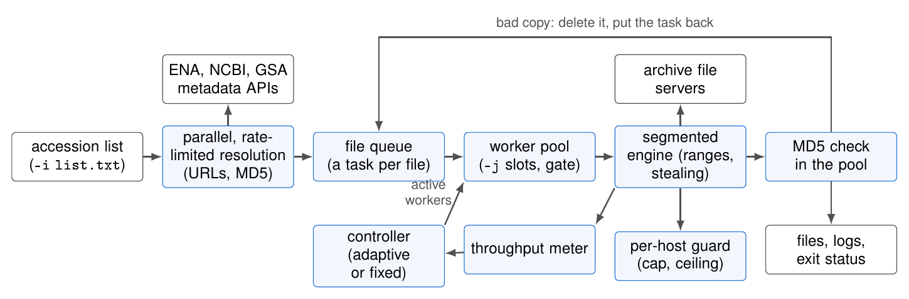

# Method details

adaptiSeq fetches every sequence-data byte through a single **download seam**, so
the scheduler and engines change only *how* bytes arrive and *when* files are
scheduled — never *which* bytes. Resolution, metadata, integrity, logs, and merge
are independent of the transport in use.

An accession list is resolved in parallel under per-archive request limits. Each file becomes a task; workers
take tasks, the segmented engine splits each file into byte ranges on several connections, a per-host guard bounds
the connections and reacts to refusals, and each finished file is md5-checked inside the pool, with a bad copy going
back to the queue. A controller (adaptive or fixed) sets how many files are in flight.

## Engines

| Engine | Flag | What it is |
| ------ | ---- | ---------- |
| **segmented** *(default)* | `--engine segmented` | Resumable, range-based HTTP(S)/FTP downloader (`aiohttp`/`aioftp`). Each file is fetched in multiple byte-range connections with atomic `.part`/`.part.meta` resume. Runs the batch worker pool and adaptive controller. |
| **classic** *(opt-in)* | `--engine classic` | The plain-tool path: `wget`, or `axel` with `-p`, plus `ascp` for `-a`. No segmentation. |

> The segmented engine **never falls back to classic**. A host that cannot serve
> ranges is downloaded as a **single stream inside the segmented engine**;
> `--engine classic` is a manual choice only.

## Transport selection (segmented, protocol `auto`)

For ENA the default is **HTTPS-first**:

1. Prefer the **HTTPS** mirror, confirmed by a cheap per-host range probe.
2. Else native **segmented FTP** (`REST`/`RETR` via `aioftp`).
3. Else a **single stream** inside the segmented engine.

`-r https` / `-r ftp` overrides and is final. A corrupt or zero-byte file is never
produced. Per-host transport is cached by **kind, not URL** (a deliberate fix — a
URL cache made every file on a host download the first file's bytes).

## Download methods summary

| Method | Used for | Notes |
| ------ | -------- | ----- |
| `segmented-https` | ENA/most HTTPS mirrors | default; multi-range, resumable |
| `segmented-ftp` | ENA FTP (`REST`/`RETR`) | when HTTPS ranges unavailable |
| `single-stream` | range-incapable hosts | inside the segmented engine; never truncated |
| `aspera (ena)` | ENA, `-a` | adaptive `ascp` pool (efficiency hysteresis) |
| `aspera (gsa)` | GSA, `-a` | sequential, Huawei-Cloud preferred; best-effort |
| `huawei-cloud` | GSA | preferred for GSA even with `-a` |
| `classic wget/axel` | `--engine classic` | the plain-tool path; `axel` with `-p` |

## Concurrency & etiquette

- **Per-file:** up to `--max-segments` byte-range connections.
- **Per-file:** idle connections take over the remainder of the largest outstanding
  range of their file (work stealing); a file that starts near the end of a list, or is
  fetched again after a bad checksum, may use the spare per-host budget.
- **Per-host:** one guard for all connections to a host. Its cap defaults to
  `-j` × `--max-segments` (`--max-conns-per-host` lowers it). A refused connect while
  other connections are open is read as the host's **connection ceiling** (wait for a
  slot, do not back off); HTTP 429/503, or a refusal with nothing open, is pushback
  (halve the cap, exponential backoff); the cap climbs back by one connection every 5 s
  without a new refusal. Responses cut short are recorded but not acted on (GSA cuts
  streams at any load).
- **Per-batch:** a worker pool (`-j`) whose active size an adaptive controller tunes
  (`--adaptive`; `--controller topdown|bottomup|budget|greedy|knee`, `topdown` by
  default; see [Adaptive controller](ADAPTIVE_CONTROLLER.md)); workers are gated at
  file-pickup boundaries.
- **Resolution:** parallel (`--meta-jobs`) under per-endpoint rate limiters
  (ENA 8 rps, GSA 5, NCBI 3, or 10 with `NCBI_API_KEY`). A failed or empty ENA answer
  is retried with backoff and is not read as "not in ENA" until about three minutes
  of continuous failure, shared by the whole list.
- **Speed:** `-s/--speed` token-bucket cap in MB/s.

## Integrity

Every Run is md5-checked against the public database (SRA uses md5 +
`vdb-validate`). In a batch, each file is hashed in the worker pool as soon as it lands;
a mismatching file is deleted and put back on the queue, so the bad copy is fetched
again in parallel with the rest of the list. After the batch a per-Run check confirms
every file and retries a Run for up to **three rounds**, then records the outcome in
`success.log` / `fail.log`. The exit status is `1` if any Run could not be delivered and
verified. `-k/--skip-md5` disables the checks.

**SRA fallback.** When ENA has no usable metadata or file for a Run, adaptiSeq can fetch
it from NCBI SRA and convert it. That FASTQ is validated but cannot be compared with
ENA's md5, so the fallback is announced and counted as unverified against ENA;
`--no-sra-fallback` makes such a Run fail instead.
